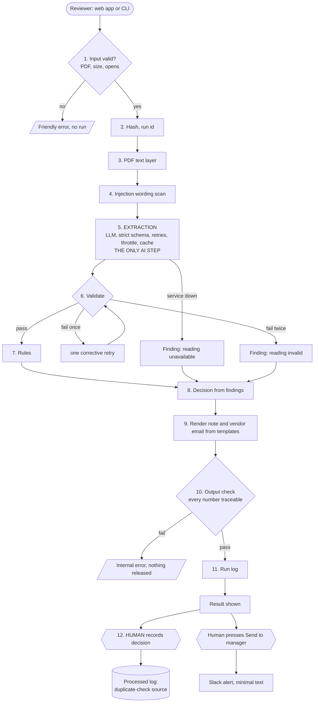

# Architecture and Data Flow (current)

This replaces the Day 2 design documents where they differ (they are kept as the historical record and now carry a banner).
Everything here describes code that exists and is tested; where something is only designed, it says so.

## 1. The one idea

**The AI reads the invoice; code decides.** A language model is called in exactly one step: turning the invoice text into a
fixed set of fields. Everything else (checking those fields, matching the PO, finding duplicates, choosing the label, writing
the reasons and the vendor email) is ordinary, testable code. A human records every final decision. Nothing is paid or sent
by the system.

Consequences that shape the rest of the design:

- The model's output is **untrusted data**. It has no channel to set a label or skip a check, which also makes injected instructions inside an invoice harmless to the decision.
- **Approve must be earned**: every failure, doubt or missing check ends in Needs review or Reject (hold), never Approve.
- Every number in a generated email or note must be traceable to a verified fact.

## 2. Component diagram

## 3. Step by step

| # | Step | Module | What it does | If it fails |
|---|---|---|---|---|
| 1 | Input check | `ap/pipeline.py` | Exists, `.pdf`, under the size limit, opens | Friendly error, nothing recorded |
| 2 | Register | `ap/pipeline.py` | SHA-256 and run id | |
| 3 | PDF text | `ap/pdf_text.py` | Text layer only (no OCR) | No text: result is Needs review, no model call |
| 4 | Injection scan | `ap/safety.py` | Regex for instruction-like wording | Adds a review finding; never blocks |
| 5 | Extraction | `ap/extraction/` | Strict-schema call, token throttle, retries on 429 and 5xx with backoff, cache by file hash | Service down: Needs review with a clear message |
| 6 | Validation | `ap/validation.py`, `ap/anchors.py` | Fence repair, schema, types, arithmetic, cross-field checks, **label anchoring**, grounding in the PDF text | One corrective retry with the reason, then Needs review |
| 7 | Rules | `ap/rules.py`, `ap/names.py` | PO lookup, **vendor vs PO vendor**, duplicates (extracted and PO vendor, ignoring voided entries), closed PO, currency, per-line quantity and price, total | PO data unreadable: Needs review |
| 8 | Decision | `ap/decision.py` | Any block finding gives Reject (hold); any review finding gives Needs review; otherwise Approve only if confidence is high | |
| 9 | Render | `ap/templates.py`, `templates/` | Plain-language note; vendor email only if the extraction validated and the vendor is not in doubt | |
| 10 | Output check | `ap/pipeline.py` | Label consistent with findings; every number in generated text appears in verified facts | Nothing is released |
| 11 | Log | `ap/storage*.py` | One record per run; a local copy always | A logging failure never hides the result |
| 12 | Human | `ap/ui_logic.py`, `app.py`, `ap/cli.py` | Record decision (the only write that changes future duplicate checks); optional manager alert | |

## 4. The validation layers, and what each one is for

These were established by deliberately breaking the system (see `docs/day4/FAILURE_ANALYSIS.md`).

| Layer | Question it answers | Catches |
|---|---|---|
| Schema and types | Is the answer well formed? | Truncated, empty, extra-field outputs |
| Arithmetic | Do quantity x price, line sums and total agree? | Shifted columns, dropped lines, a line copied as total |
| Grounding | Is the value actually printed in the document (either number convention)? | Hallucinated PO numbers, flipped currency |
| Label anchoring | Is it printed *next to the right label*? | Delivery date as invoice date, customer reference as invoice number, subtotal as total |
| Vendor vs PO | Is the issuer the vendor the PO was raised with? | Customer or remit-to name taken for the vendor |
| Confidence gate | Did anything need a retry or stay unverified? | Sends such results to a person |

## 5. Data stores

| Store | Local backend | Google Sheets backend | Written by |
|---|---|---|---|
| Purchase orders | `data/pos.csv`, `data/po_lines.csv` | tabs `POs`, `PO_Lines` | Finance staff (read-only to the tool) |
| Processed invoices | `data/processed_invoices.csv` | tab `Processed` | Only the human decision step. An operator sets `human_decision` to `void` to cancel an entry |
| Run history | `logs/runs.jsonl` | tab `Runs` (plus a local copy) | Every check |
| Events | `logs/events.jsonl` | tab `Events` | Manager escalations |
| Extraction cache | `cache/extractions/` | same | Live extractions, keyed by file hash, model and prompt version |

Backends implement one interface (`ap/storage.py: Storage`), so a third backend needs no pipeline change.

## 6. Configuration and secrets

All environment-specific values live in `.env` (copy `.env.example`) or `secrets/`; both are git-ignored. Business policy
(tolerances, supported currencies, escalation threshold) is in `config/policy.yaml`.

| Setting | Purpose |
|---|---|
| `EXTRACTION_MODE` | `mock` (demo samples only, no key) or `live` |
| `LLM_*` | Provider, base URL, key, model, limits. Any OpenAI-compatible endpoint (Groq, Ollama) |
| `STORAGE_BACKEND`, `GOOGLE_*` | `csv` or `sheets` |
| `NOTIFY_BACKEND`, `SLACK_WEBHOOK_URL` | `none`, `console` or `slack` |

Secrets are never logged, never shown in error messages, and are excluded from the packaged repository.

## 7. Trust boundaries

| Boundary | Rule |
|---|---|
| Invoice text to model | Passed as quoted data; the model is told to ignore instructions inside it |
| Model to system | Output must match a strict schema and survive validation; it can set no label |
| System to vendor | Nothing is ever sent; a draft is shown. No draft is produced when the extraction is invalid or the vendor is in doubt |
| System to manager | A short message, sent only when a person presses the button; contains no invoice text |
| System to storage | Writes use RAW mode (no formula injection); the sheet is shared with one service account only |
| System to payments | None. There is no payment integration |

## 8. What changed since the Day 2 design

New finding code `VENDOR_MISMATCH`; label anchoring (`ap/anchors.py`); vendor-name comparison (`ap/names.py`); both-convention
number reading; code-fence and numeric-string tolerance with a `repairs` record; the `void` convention; run history and
event accessors; the web app, Sheets adapter, Slack notifier, setup checker and adoption report. The four safeguards in
`validate()` that take switches (`check_arithmetic`, `check_grounding`, `check_consistency`, `check_anchoring`) exist only
so evaluation can switch one off at a time.
