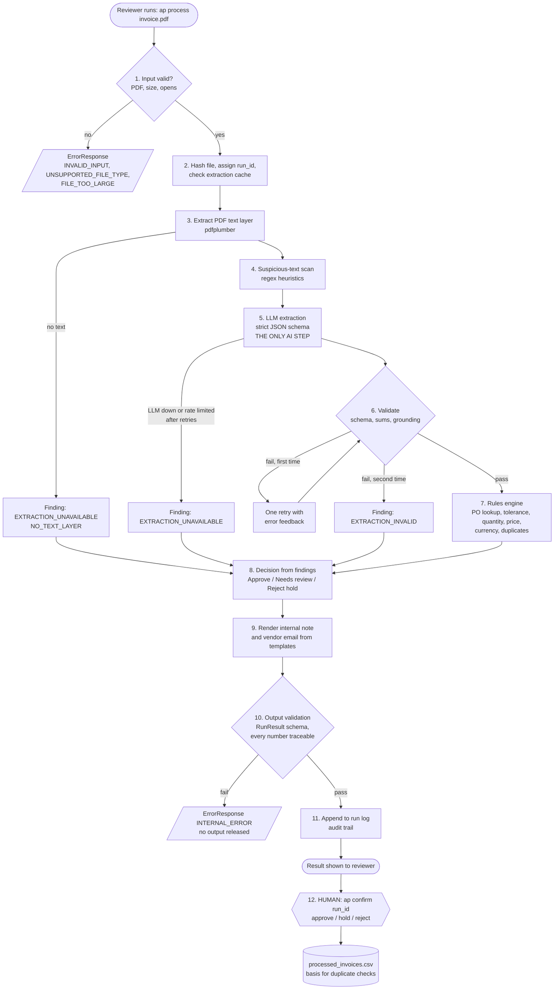

# A. System Architecture and End-to-End Data Flow

> **Historical design document (Day 2).** Parts of it are superseded by later work (label anchoring, vendor-vs-PO check, number-format handling, void, run history). For how the system works now, read `docs/ARCHITECTURE.md`.


Design principle: **AI reads the invoice; code decides.** The LLM is called in exactly one step (field extraction). Matching, tolerances, duplicate checks, the decision label, the reasons and the vendor email are deterministic code and templates. The LLM has no authority over the outcome, which is also the structural defence against prompt injection.

One Python package, one CLI, flat files for storage. No services, queues or containers: that is deliberate for a five-day individual sprint.

## 1. Diagram



## 2. Step-by-step data flow

| # | Step | Module | Input | Output | AI? | On failure |
|---|---|---|---|---|---|---|
| 1 | Validate input | `ap/cli.py`, `ap/pipeline.py` | File path | Accepted file or `ErrorResponse` | No | Return `INVALID_INPUT`, `UNSUPPORTED_FILE_TYPE` or `FILE_TOO_LARGE`; no run is created |
| 2 | Hash and register | `ap/pipeline.py` | File bytes | `run_id`, SHA-256, cache lookup | No | Internal error response |
| 3 | PDF text | `ap/pdf_text.py` | PDF | Normalized text | No | No text layer: skip to decision with `EXTRACTION_UNAVAILABLE` (OCR is a non-goal) |
| 4 | Suspicious-text scan | `ap/safety.py` | Text | `SUSPICIOUS_TEXT` finding if patterns match | No | Never blocks processing; adds a review finding |
| 5 | Extraction | `ap/extraction/*` | Text + wire schema | `LLMExtraction` JSON | **Yes** | Retry on 429/5xx/timeout with backoff; then `EXTRACTION_UNAVAILABLE` |
| 6 | Validate | `ap/validation.py` | `LLMExtraction` + text | `ExtractedInvoice` + `ValidationReport` | No | One corrective retry, then `EXTRACTION_INVALID`; no guessing |
| 7 | Rules | `ap/rules.py` | `ExtractedInvoice`, PO record, processed log, policy | List of `Finding` | No | PO source unreadable: `PO_SOURCE_UNAVAILABLE`, result forced to Needs review |
| 8 | Decide | `ap/decision.py` | Findings | `Label` | No | Any unresolved doubt defaults to Needs review |
| 9 | Render | `ap/templates.py` + `templates/` | Findings, extracted data | Internal note, vendor email | No | Missing template: generic fallback text with only verified facts |
| 10 | Output validation | `ap/pipeline.py` | `RunResult` | Validated JSON | No | Failing output is not released |
| 11 | Run log | `ap/storage.py` | `RunResult` | Line in `runs.jsonl` | No | Log failure is reported, result still shown |
| 12 | Human confirm | `ap/cli.py confirm` | `run_id`, human decision | Row in `processed_invoices.csv` | No | Unknown `run_id` rejected |

## 3. Decision logic (step 8)

1. If any finding has severity `block` (exact duplicate, PO not found, PO closed): **Reject (hold)**.
2. Else if any finding has severity `review`, or extraction did not validate, or the PO source is unavailable: **Needs review**.
3. Else if all critical fields were extracted, grounded and validated, the PO was found and open, and all rules passed: **Approve**.
4. Everything else: **Needs review**.

`Approve` is therefore the only label that must be earned. Every failure path ends at Needs review or Reject. The result always carries `requires_human_confirmation = true`.

## 4. Where AI is and is not involved

| Task | Owner | Reason |
|---|---|---|
| Read invoice fields from varying layouts | LLM | Layouts vary; this is where AI earns its place |
| Compare amounts, quantities, currency; duplicate check; PO candidates | Code | Deterministic and unit-testable |
| Decision label and reasons | Code | Reasons come straight from findings |
| Vendor email and internal note | Templates | No invented facts, free, consistent |
| Detecting embedded instructions | Code heuristics, plus architecture | The LLM only fills a schema and cannot influence the label |
| Approve, send, pay | Human | Irreversible actions stay human |

## 5. Stores

| Store | Format | Written by | Purpose |
|---|---|---|---|
| `data/pos.csv` | CSV (PO header and lines in `data/po_lines.csv`) | Data generator (synthetic) | PO lookup. Read-only to the pipeline |
| `data/processed_invoices.csv` | CSV | `confirm` only | Duplicate detection |
| `logs/runs.jsonl` | JSON lines | Pipeline, every run | Audit trail, evaluation input |
| `cache/extractions/` | JSON by `sha256 + model + prompt_version` | Extraction step | Avoid burning free-tier tokens; reproducibility. Bypassed with `--no-cache` |

All store access goes through a `Storage` interface, so Day 3 can add a Google Sheets adapter without changing pipeline code.

## 6. Planned layout

```
ap-invoice-system/
  ap/
    cli.py  pipeline.py  config.py  schemas.py  pdf_text.py
    validation.py  rules.py  decision.py  templates.py  safety.py  storage.py
    extraction/  base.py  openai_compatible.py  mock.py
  config/policy.yaml          # tolerances, supported currencies, limits
  templates/                  # one text template per exception type
  scripts/generate_data.py    # synthetic invoices, POs, log, expected results
  data/  logs/  cache/  tests/  docs/day2/
  .env.example  requirements.txt  README.md
```

## 7. Appropriate for the sprint

- No web server, database server, queue, or container in v0.
- One external dependency of substance (the LLM endpoint). Everything else runs offline.
- The same OpenAI-compatible adapter serves Groq and Ollama; mock mode needs no network.
- Day 3 additions (Streamlit UI, Google Sheets, a notification channel) plug into the interfaces above without restructuring.
